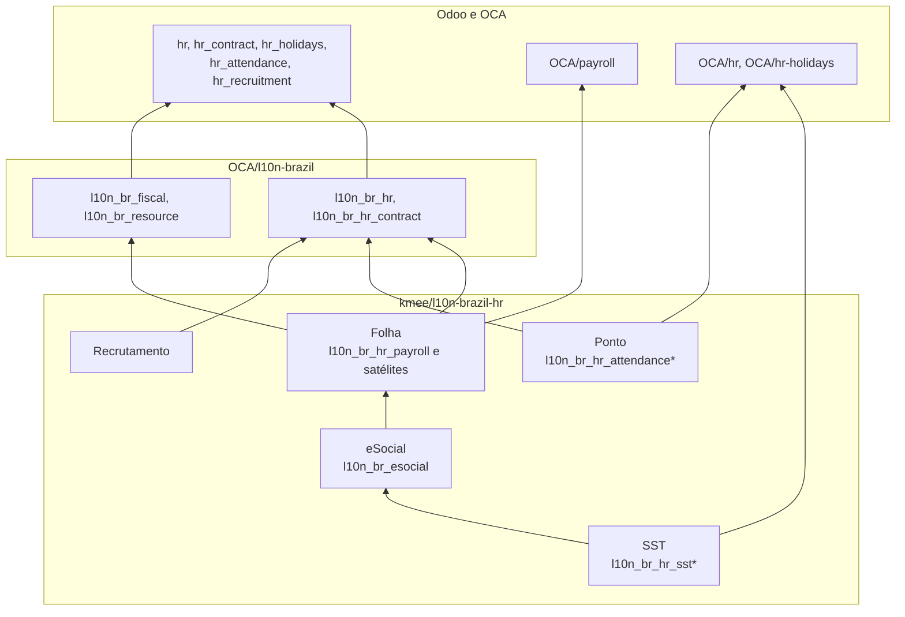

# Arquitetura do l10n-brazil-hr

Este documento explica como os módulos deste repositório se encaixam na localização
brasileira do Odoo, por que o RH vive num repositório separado e onde cada tipo de
mudança deve ser feita.

## Visão geral

O repositório é uma camada de RH em cima de três fontes:

1. **Odoo** (core): `hr`, `hr_contract`, `hr_holidays`, `hr_attendance`,
   `hr_recruitment`, `hr_expense`, `website_hr_recruitment`.
2. **OCA/l10n-brazil**, o repositório principal da localização brasileira: o cadastro de
   RH (`l10n_br_hr`, `l10n_br_hr_contract`), a base fiscal (`l10n_br_base`,
   `l10n_br_fiscal`), os calendários e feriados (`l10n_br_resource`) e, só no CI, o
   plano de contas (`l10n_br_coa_generic`).
3. **Outros repositórios da OCA**: a folha genérica (`payroll`, `payroll_account`,
   `payroll_contract_advantages`, do OCA/payroll), cadastros de RH
   (`hr_employee_relative`, `hr_employee_medical_examination`, `hr_employee_ppe`, do
   OCA/hr) e feriados por cidade (`hr_holidays_public_city`, do OCA/hr-holidays).

Bibliotecas Python: [`esociallib`](https://pypi.org/project/esociallib/) (bindings dos
leiautes do eSocial gerados dos XSD oficiais), `erpbrasil.base` (validação e formatação
de documentos) e `erpbrasil.assinatura` (assinatura digital dos eventos e do AEJ).

## Áreas e dependências entre os módulos

As dependências abaixo saem dos manifestos (`depends`) da série 18.0. A folha é o
centro: quase tudo depende de `l10n_br_hr_payroll`.

### Folha de pagamento

| Módulo                          | Depende de (neste repositório)                        | Papel                                                                                                            |
| ------------------------------- | ----------------------------------------------------- | ---------------------------------------------------------------------------------------------------------------- |
| `l10n_br_hr_payroll`            | nenhum                                                | Regras salariais brasileiras: INSS, IRRF, FGTS, adicionais, encargos patronais por regime tributário e provisões |
| `l10n_br_hr_payroll_account`    | `l10n_br_hr_payroll`                                  | Contabilização do holerite (diário da folha, contas por rubrica)                                                 |
| `l10n_br_hr_payroll_report`     | `l10n_br_hr_payroll`, `l10n_br_hr_vacation`           | Holerite com layout brasileiro                                                                                   |
| `l10n_br_hr_benefit`            | `l10n_br_hr_payroll`                                  | Benefícios (VT, VR, VA, plano de saúde) sobre o `payroll_contract_advantages`                                    |
| `l10n_br_hr_holiday`            | `l10n_br_hr_payroll`                                  | Tipos de afastamento e faltas da CLT                                                                             |
| `l10n_br_hr_vacation`           | `l10n_br_hr_payroll`                                  | Férias, abono pecuniário, 13º salário e rescisão                                                                 |
| `l10n_br_hr_substituicao`       | `l10n_br_hr_payroll`                                  | Substituição temporária (CLT, art. 450)                                                                          |
| `l10n_br_hr_syndicate`          | `l10n_br_hr_payroll`                                  | Sindicato do contrato                                                                                            |
| `l10n_br_hr_validacao_folha`    | `l10n_br_hr_payroll`                                  | Consistências antes de confirmar o holerite                                                                      |
| `l10n_br_hr_gerador_holerite`   | `l10n_br_hr_payroll`                                  | Geração em lote de holerites para simulação                                                                      |
| `l10n_br_ressarcimento`         | `l10n_br_hr_payroll`                                  | Reembolso de despesas do empregado pelo holerite                                                                 |
| `l10n_br_ressarcimento_account` | `l10n_br_ressarcimento`, `l10n_br_hr_payroll_account` | Contabilização do reembolso                                                                                      |
| `l10n_br_hr_arquivos_governo`   | `l10n_br_hr_payroll`, `l10n_br_hr_benefit`            | Descontinuado (SEFIP, DIRF e CAGED extintos); mantido só para consulta                                           |

### eSocial

| Módulo                | Depende de                                                       | Papel                                                                           |
| --------------------- | ---------------------------------------------------------------- | ------------------------------------------------------------------------------- |
| `l10n_br_esocial`     | `l10n_br_hr_payroll`                                             | Eventos e lotes (leiaute S-1.3), ciclo até a DCTFWeb, leitura dos totalizadores |
| `l10n_br_esocial_sst` | `l10n_br_hr_sst_epi`, `l10n_br_hr_sst_aso`, `l10n_br_hr_sst_cat` | Eventos de SST: S-2210, S-2220, S-2221 e S-2240                                 |

### Saúde e Segurança do Trabalho (SST)

| Módulo                   | Depende de                             | Papel                                              |
| ------------------------ | -------------------------------------- | -------------------------------------------------- |
| `l10n_br_hr_sst`         | `l10n_br_esocial`                      | Inventário de riscos ocupacionais (PGR, LTCAT)     |
| `l10n_br_hr_sst_epi`     | `l10n_br_hr_sst`                       | Entrega de EPI (NR-6) com Certificado de Aprovação |
| `l10n_br_hr_sst_aso`     | `l10n_br_hr_sst`                       | Exames ocupacionais e PCMSO (NR-7)                 |
| `l10n_br_hr_sst_cat`     | `l10n_br_hr_sst`                       | Acidente de trabalho e CAT                         |
| `l10n_br_hr_payroll_sst` | `l10n_br_hr_sst`, `l10n_br_hr_payroll` | Insalubridade e periculosidade derivadas do laudo  |

### Ponto eletrônico (Portaria MTP 671/2021)

| Módulo                                  | Depende de                                               | Papel                                                            |
| --------------------------------------- | -------------------------------------------------------- | ---------------------------------------------------------------- |
| `l10n_br_hr_attendance`                 | nenhum                                                   | Base do registro de ponto                                        |
| `l10n_br_hr_attendance_afd`             | `l10n_br_hr_attendance`                                  | Importação e geração do AFD                                      |
| `l10n_br_hr_attendance_apuracao`        | `l10n_br_hr_attendance`, `l10n_br_hr_holidays_public`    | Motor de apuração da jornada pelas regras da CLT                 |
| `l10n_br_hr_attendance_aej`             | `l10n_br_hr_attendance_apuracao`                         | AEJ e espelho de ponto                                           |
| `l10n_br_hr_attendance_integridade`     | `l10n_br_hr_attendance_aej`, `l10n_br_hr_attendance_afd` | Integridade do programa de tratamento de ponto (PTRP)            |
| `l10n_br_hr_payroll_attendance`         | `l10n_br_hr_payroll`, `l10n_br_hr_attendance_apuracao`   | Dias trabalhados, horas extras e faltas do ponto para o holerite |
| `l10n_br_hr_holidays_public`            | nenhum                                                   | Importa os feriados brasileiros para o calendário                |
| `l10n_br_hr_overtime_custom_multiplier` | `l10n_br_hr_holidays_public`                             | Multiplicador de horas extras por faixa e dia                    |
| `hr_overtime_report_action_pdf`         | `l10n_br_hr_overtime_custom_multiplier`                  | Relatório PDF das horas extras                                   |

### Recrutamento

| Módulo                                | Depende de               | Papel                                                  |
| ------------------------------------- | ------------------------ | ------------------------------------------------------ |
| `l10n_br_hr_recruitment`              | nenhum                   | Dados brasileiros do candidato, levados ao funcionário |
| `l10n_br_website_hr_recruitment_form` | `l10n_br_hr_recruitment` | Formulário público para o candidato completar os dados |

### Módulo técnico

`l10n_br_hr_setup_tests` só existe para o CI: depende do `l10n_br_coa_generic` para que
as empresas de demonstração tenham plano de contas. Não deve ser instalado em produção.

## Fluxos principais

**Folha.** Contrato (`l10n_br_hr_contract`) -> holerite com as regras de
`l10n_br_hr_payroll` (o regime tributário vem do `l10n_br_fiscal`) -> lançamento
contábil (`l10n_br_hr_payroll_account`) -> eventos periódicos do eSocial (S-1200,
S-1210, S-1299) -> totalizadores devolvidos pelo governo (S-5001, S-5011 e outros),
conferidos contra a folha.

**Ponto.** Marcações (importadas do AFD do relógio ou registradas no Odoo) -> apuração
diária pelas regras da CLT -> AEJ e espelho de ponto -> dias trabalhados, horas extras e
faltas no holerite (`l10n_br_hr_payroll_attendance`).

**SST.** Inventário de riscos -> entrega de EPI, ASO e CAT -> eventos S-2210, S-2220,
S-2221 e S-2240 -> adicionais de insalubridade e periculosidade na folha
(`l10n_br_hr_payroll_sst`).

## Por que um repositório separado

O RH ficava no `kmee/kmee-odoo-addons`, misturado com módulos de vendas, CRM, estoque e
helpdesk. Ele foi extraído, com o histórico git de cada módulo, por quatro motivos:

1. **Domínio próprio.** O RH tem dependências que o resto da localização não usa
   (OCA/payroll, OCA/hr, `esociallib`) e um calendário regulatório próprio (leiautes do
   eSocial, Portaria MTP 671/2021, normas regulamentadoras). Num repositório só dele,
   uma mudança de leiaute ou de tabela não espera pelo ritmo de módulos sem relação.
2. **CI focado.** O CI deste repositório instala e testa só o RH e as suas dependências.
   No repositório de origem, um teste quebrado num módulo de vendas travava um PR de
   folha, e o contrário também.
3. **Instalação limpa.** Quem precisa só de RH agrega um repositório que só tem RH.
4. **Caminho para a OCA.** O repositório segue o template da OCA (manifestos com a OCA
   entre os autores, AGPL-3, pre-commit e CI da OCA), para que os módulos maduros possam
   ser propostos à OCA sem retrabalho.

### O que fica no OCA/l10n-brazil

O [OCA/l10n-brazil](https://github.com/OCA/l10n-brazil) continua dono do **cadastro**:
os campos brasileiros do funcionário e do contrato (`l10n_br_hr`,
`l10n_br_hr_contract`), a base fiscal e os feriados. A regra prática:

- Campo ou validação do cadastro do funcionário, do contrato ou da empresa que qualquer
  instalação brasileira usa: vai para o OCA/l10n-brazil.
- Cálculo de folha, evento do eSocial, SST, ponto, férias, benefícios, recrutamento: vem
  para cá.

Este repositório não sobrescreve nem duplica campo do OCA/l10n-brazil. Se um módulo
daqui precisa de algo no cadastro, a mudança é proposta lá.

### Repositórios irmãos

O mesmo modelo (repositório da KMEE no template da OCA, uma branch por série, incubadora
para a OCA) é usado em outras áreas da localização:

- [kmee/l10n-brazil-fiscal-contrib](https://github.com/kmee/l10n-brazil-fiscal-contrib):
  grupos específicos de documentos fiscais (NF-e, NFC-e, NFS-e, CT-e) para segmentos de
  nicho.

Os dois não dependem um do outro: o RH só usa da parte fiscal o `l10n_br_fiscal` do
OCA/l10n-brazil.

## Séries

O repositório tem uma branch por versão do Odoo em que o OCA/l10n-brazil tem o
`l10n_br_hr` instalável.

| Série | Módulos           | Observação    |
| ----- | ----------------- | ------------- |
| 16.0  | todos             |               |
| 17.0  | todos             |               |
| 18.0  | todos             | branch padrão |
| 19.0  | só o recrutamento | ver abaixo    |

Na 19.0 a cadeia de folha, eSocial, SST e ponto ainda não existe: o OCA/l10n-brazil 19.0
não tem o `l10n_br_hr_contract` (no Odoo 19 o `hr_contract` foi absorvido pelo `hr`), e
o `payroll_account`, o `hr_employee_ppe` e o `hr_holidays_public_city` ainda não têm
versão 19.0. Levar a folha para a 19.0 é uma migração de verdade, não uma cópia.

## Decisões técnicas que valem para todo o repositório

- **Documentos só com dígitos.** A partir da 18.0, o `l10n_br_hr` grava o CPF e o PIS do
  funcionário sem pontuação, como pedem os leiautes do eSocial. Tela e relatório
  formatam na exibição (por exemplo, com `erpbrasil.base.fiscal.cnpj_cpf.formata`);
  nunca gravar formatado.
- **Domínio do eSocial vem do leiaute.** Os valores válidos de cada campo (tabelas e
  enumerações) se conferem nos bindings da `esociallib`, gerados dos XSD oficiais, e não
  de memória ou de documento secundário. Um valor errado só aparece na rejeição do
  evento, depois do prazo legal.
- **Critério legal com fonte.** Regra de cálculo, alíquota, prazo ou validação cita a
  norma no código ou no README do módulo (lei, artigo, portaria, NR). Valores que mudam
  com o tempo ficam em tabelas com vigência, não em constantes.
- **Dados pessoais.** Eventos e holerites carregam CPF e remuneração: acesso restrito
  aos grupos de folha e regras multiempresa. Teste e demo usam documentos gerados, nunca
  de pessoas reais.

## Histórico

A evolução da folha até a extração está registrada no repositório de origem, incluindo o
documento de requisitos da folha
([`docs/PRD-folha-pagamento-evolucao.md`](https://github.com/kmee/kmee-odoo-addons/blob/16.0/docs/PRD-folha-pagamento-evolucao.md),
série 16.0 do `kmee/kmee-odoo-addons`). O histórico git de cada módulo foi preservado na
extração: `git log -- <módulo>` mostra os commits de origem.
